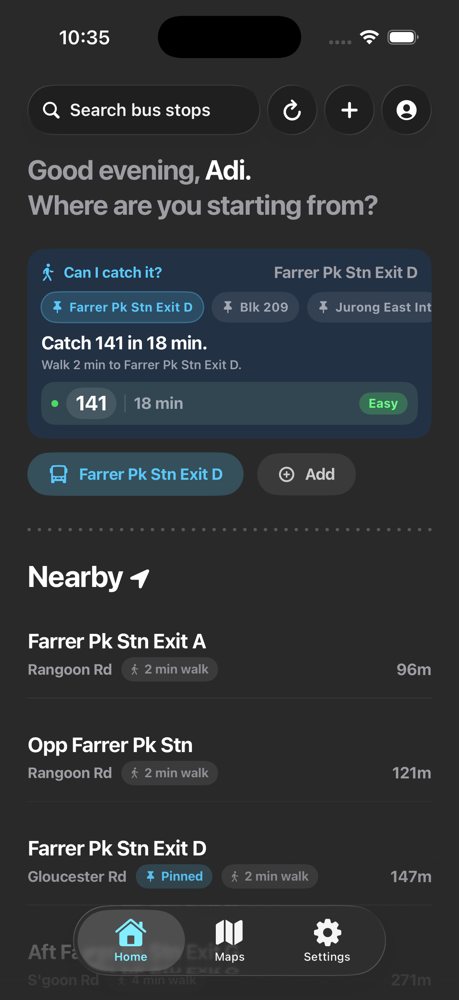
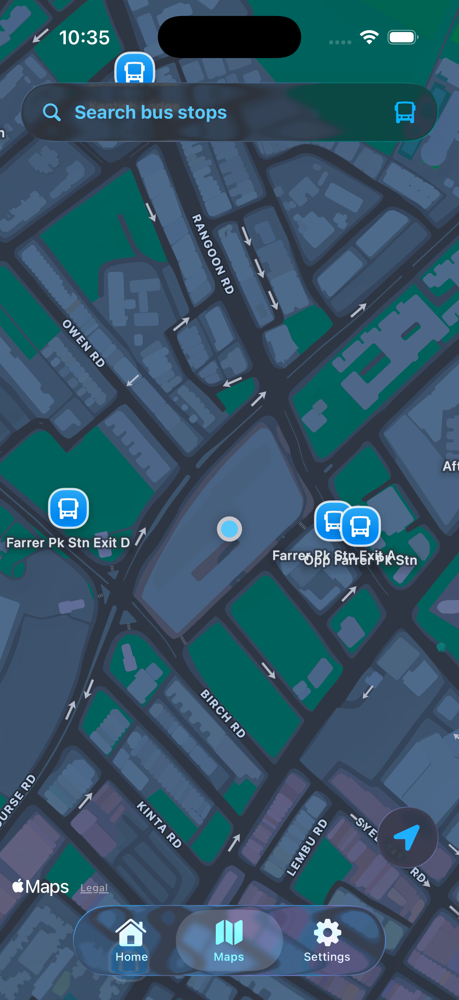

# Catch — SG Buses

### Less checking. Better timing.

A native iPhone app that turns Singapore bus arrivals into a practical decision: **leave now, or wait for the next bus.**

[**Download on the App Store**](https://apps.apple.com/sg/app/catch-sg-buses/id6777373130) · [**Portfolio**](https://adiarya.com) · [**Explore the code**](#inside-the-project)

**SwiftUI · ActivityKit · WidgetKit · MapKit · SwiftData · StoreKit**

---

## The idea

A bus arriving in five minutes is only useful information if you know whether you can reach it.

Catch brings live arrival predictions, nearby stops, saved places and walking-time estimates into one focused experience. Its core interaction, **“Can I catch it?”**, translates timings into an understandable next action rather than another number to interpret.

Designed and built by **Aditya Arya**, Catch combines product design with native iOS development: from the main commute flow to the small details that make an app useful on the Home Screen, Lock Screen and Dynamic Island.

## A look at Catch

  
  &nbsp;&nbsp;
  

Repository development screenshots. The current App Store build may differ.

## What it does

- **Live bus arrivals:** view upcoming services and arrival estimates from Singapore's LTA DataMall.
- **Can I catch it?:** compare arrival timing with walking time, with clear states for a comfortable connection, leaving now, or a connection that is too tight.
- **Saved places and pinned buses:** keep familiar stops and preferred services close, with custom labels and ordering.
- **Nearby discovery:** search stops and explore them on a native map.
- **Live Board:** follow a selected service through Live Activities and Dynamic Island without repeatedly reopening the app.
- **Home Screen widgets:** surface saved places and bus timings through shared app-group snapshots.
- **Leave-now alerts:** schedule local notifications around an active Live Board trip.
- **Siri and Shortcuts:** expose transit actions through App Intents.
- **Catch Pro:** StoreKit-based purchase and entitlement handling, with a local StoreKit configuration for development.
- **Feedback loop:** an in-app feedback board backed by Supabase client code and database migrations.

## Engineering decisions worth exploring

### 1. Design around a decision, not a data feed

Catch's catchability logic combines bus arrival estimates with walking time and presents a small set of actionable states. The same idea extends into widget data, so the experience remains recognisable outside the app.

**Read:** [AppState.swift](Catch/Services/AppState.swift) · [CatchWidgetData.swift](Catch/Models/CatchWidgetData.swift)

### 2. Treat live UI as a lifecycle problem

Live Activities involve more than drawing a countdown. Starting, updating and dismissing them can overlap as asynchronous work completes.

The Live Activity manager uses an operation revision to prevent an older start request from recreating an activity after a newer action. It also handles stale content, bus-prediction rollover, push-token registration and cleanup. Remote registration cleanup is kept separate from immediate dismissal of the system UI.

**Read:** [LiveActivityManager.swift](Catch/Services/LiveActivityManager.swift) · [Live Activity extension](CatchLiveActivity/CatchLiveActivity.swift)

### 3. Share a snapshot, not the entire app

Widgets read a Codable snapshot through an App Group. This gives the extension a defined representation of stops, pinned services, arrival estimates and membership state instead of coupling it directly to every screen's state.

**Read:** [Snapshot model and store](Catch/Models/CatchWidgetData.swift) · [Widgets](CatchWidgets/CatchWidgets.swift)

### 4. Keep network work asynchronous

The LTA service is implemented as a Swift actor, using async URLSession requests, response validation and Codable decoding. Bus-stop loading uses concurrent paginated requests, and route summaries are cached within the service.

**Read:** [LTAService.swift](Catch/Services/LTAService.swift) · [Bus models](Catch/Models/BusModels.swift)

### 5. Build beyond the main screen

The repository includes separate app, widget and Live Activity targets, App Intents, local persistence, purchase flows, and backend support for feedback and remote Live Activity refresh.

This is a product integration project as much as a UI project: system surfaces, permissions, changing arrival predictions and app lifecycle transitions all affect the commuter's experience.

## Inside the project

| Area | Responsibility |
| --- | --- |
| [`Catch/Views`](Catch/Views) | SwiftUI screens, onboarding, stop details, maps, settings and purchases |
| [`Catch/Services`](Catch/Services) | App state, location, transit requests, Live Activities, feedback and App Intents |
| [`Catch/Models`](Catch/Models) | Transit models and shared widget/Live Activity data |
| [`CatchWidgets`](CatchWidgets) | WidgetKit extension |
| [`CatchLiveActivity`](CatchLiveActivity) | Lock Screen and Dynamic Island presentation |
| [`supabase`](supabase) | Database migrations and a remote-refresh Edge Function |
| [`backend`](backend) | Feedback-backend setup notes |
| [`verification`](verification) | Historical verification notes, screenshots and focused checks |
| [`Legal`](Legal) | Privacy, terms and submission documentation |

## Running locally

The Xcode project currently targets **iOS 18.0 or later**.

1. Clone the repository and open `Catch.xcodeproj` in Xcode on macOS.
2. Select the **Catch** scheme.
3. Configure your own signing team, bundle identifiers, App Group and relevant capabilities for the app and extension targets.
4. Configure your own authorised LTA DataMall access privately for both the app and widget. See [local LTA configuration and credential safety](docs/LTA_CONFIGURATION.md). Do not commit real credentials.
5. For feedback, configure your own Supabase project and client configuration. See [backend setup](backend/README.md).
6. Build and run on a compatible simulator or iPhone. Use a physical device to validate location, notifications and system-surface behaviour.

For remote Live Activity refresh, the repository contains a [worker and setup guide](supabase/functions/live-activity-refresh/README.md). Deploying it requires separate server-side configuration, APNs credentials and scheduling. Never bundle APNs private keys or Supabase service-role credentials in the app.

> The existence of backend code does not confirm that a service is deployed or configured for your environment. Some older setup notes describe earlier implementation stages.

## Scope and reliability

- Catch is an independent app, not an official LTA application.
- Arrival predictions and walking-time estimates can change. Catch is a planning aid, not a guarantee that a bus can be caught.
- Local countdown progression is different from receiving fresh predictions while the app is suspended. Background refresh depends on server configuration, connectivity and iOS behaviour.
- The verification directory records development checks and earlier testing. It is not a claim that every current flow has passed an automated test suite.
- This repository documents the implementation available here; it does not claim production-scale performance, usage figures or features beyond the code.

## About the maker

I'm **Aditya Arya**, a Singapore-based product designer and app developer. I built Catch to explore how thoughtful interaction design and native platform capabilities can make an everyday task feel simpler.

Interested in the design process or working together? **[See my portfolio →](https://adiarya.com)**
